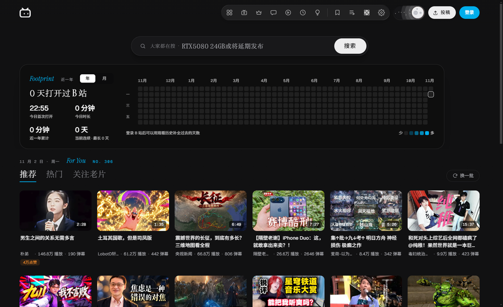
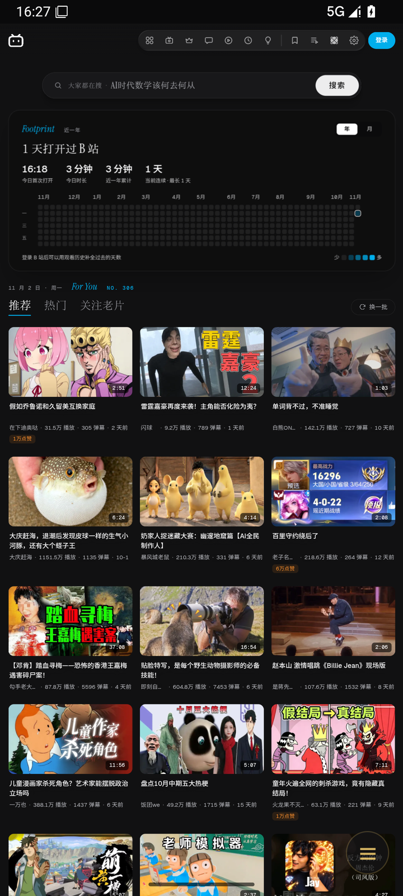
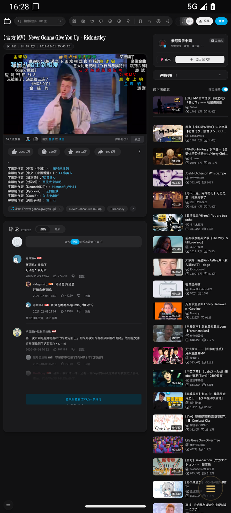

# zerobili

<p align="center"></p>

把 [映间 MARGIN](https://github.com/jiuyang5354/bilibili-margin) 这套 B 站改版界面装进壳里的客户端，**Windows + Android 双端**。

页面永远是真正的 `bilibili.com`，MARGIN 负责把它重新排一遍。播放、登录、弹幕、评论、投币收藏全部走 B 站原生能力——没有自己抓接口、没有自己实现播放器，所以不会出现「第三方客户端又崩了」「登录态被风控」这类问题。

## 下载

| 平台 | 文件 | 要求 |
| --- | --- | --- |
| Windows | [`zerobili-0.1.0-setup.exe`](../../releases/latest) | Windows 10 / 11 x64 |
| Android | [`zerobili-0.1.0-android.apk`](../../releases/latest) | Android 8.0+（minSdk 26） |

Windows 安装包没有代码签名，SmartScreen 会提示「未知发布者」，点「更多信息 → 仍要运行」即可。Android 包用的是 debug 证书签的，装得上、能升级，但**不适合上应用商店**（换签名要卸载重装）。

## 界面

| Windows | Android 首页 | Android 播放页 |
| --- | --- | --- |
|  |  |  |

## 为什么不是「套个网页」

因为套网页解决不了这两件事：**界面**和**内存**。

- **界面**：MARGIN 是一套完整重写的 B 站皮肤——自定义顶栏、足迹热力图、卡片栅格、玻璃质感、字体排版。它本身是浏览器扩展，直接开浏览器也能用，但那样要拖着一个完整浏览器。
- **内存**：原版 B 站首页在 Electron 里要 749 MB。这个客户端把 MARGIN 里最贵的部分（WebGL/WebGPU 3D 背景）拆掉之后，首页降到 550 MB 上下，同时 `native-guard` 在 `document_start` 拦掉原版脚本，DOM 节点从 1482 掉到 640 左右。

两端做的事一样，只是「扩展运行环境」的搭法不同：

| | Windows | Android |
| --- | --- | --- |
| 内核 | Electron 33（Chromium 130） | 系统 WebView |
| 扩展资源 | `margin://` 自定义协议 | `shouldInterceptRequest` 拦 `/__margin__/` |
| `chrome.*` | preload 里 shim，storage 走 IPC 落 JSON | shim 落 localStorage |
| 注入时机 | preload + `webFrame.executeJavaScript` | `evaluateJavascript` 轮询 `documentElement` |
| 外壳 | 自绘 40px 标题栏 | 无标题栏 + 悬浮菜单 |

## 对 MARGIN 做的改造

不只是套壳，插件本体也做了减法：

| 改动 | 说明 |
| --- | --- |
| 移除 3D 背景 | `src/content/bg/background.ts` 从整套 WebGL/WebGPU 渲染掏空成空实现，13 款 shader、玻璃透镜、Gate 流全部删除。对外 API（`el / apply / shader / setLens / setFocus / redraw / hold / cap`）保持不变，首页/接管页/播放页三类调用方零改动 |
| 移除 flux.js | 底层 WebGPU 计算管线，约 200KB 独立产物，随 3D 背景一起从构建里删掉 |
| 移除背景设置 UI | 设置面板里的背景模式、13 款样式缩略图、强度、自定义图片上传整段删除 |
| 移除天气卡 | 整块拿掉：卡片、点阵天空（`dotsky.ts`）、天气接口、城市定位、设置面板里的「天气」「天气城市」两项。首页顶部现在只留足迹热力图 |
| 削减模糊 | 顶栏三块玻璃原本是 `blur(8px) + SVG 置换滤镜`，置换滤镜每帧都要采样一张位移图，是玻璃效果里最贵的一档。改成纯 `blur(12px)`；足迹卡 24→14px、抽屉 28→18px、搜索框 18→12px，顶栏下面那层二次模糊（`blur(6px)` 的 `.top::before`）整条删掉 |

保留的是排版、玻璃质感与 `backdrop-filter` 模糊 —— 这些是纯合成层开销，不额外占渲染上下文。

## 内存（Windows 实测）

同一台机器，页面稳定后取 `app.getAppMetrics()` 汇总：

| 场景 | 总内存 | 构成 |
| --- | --- | --- |
| 原版 B 站首页（无 MARGIN） | 749 MB | 渲染 348 MB |
| zerobili 首页 | **约 550–590 MB** | Browser 113 / GPU 169 / Utility 54 / 壳 82 / B站页 168 |
| 播放页 | 约 1030 MB | 视频解码 + 弹幕，原生播放器 |

首页省下约 200 MB，两个来源：MARGIN 的 `native-guard` 在 `document_start` 拦掉原版脚本（节点数 1482 → 640），以及 3D 背景不再常驻 GPU 上下文。

**「能不能更小」实测过这些，结论是硬结构压不动：**

| 尝试 | 结果 |
| --- | --- |
| 一堆 `--disable-features`（SpareRenderer、BackForwardCache、Translate、Prerender…） | 573 MB，比基线还高，基本是白费功夫 |
| `--disable-gpu`（关硬件加速） | GPU 146→99，但渲染进程 151→197，总量不变，还丢掉硬解 |
| `--in-process-gpu`（GPU 并进主进程） | 515 MB，省 38 MB，但 GPU 卡顿会顶到主进程 |
| 移除壳页（标题栏注入页面） | 理论省 78 MB，未做 |

`Browser + GPU + Utility` 约 310 MB 是 Electron 的固定成本，跟页面无关。

## Android 端

同一套注入逻辑，壳换成 WebView。**实测跑通的**（Android 16 x86_64 模拟器）：

- 首页：`margin-root: true`，DOM 634 节点，3 列卡片栅格，足迹热力图正常计时
- 播放页：`margin-watch` 皮肤生效，`<video>` 的 `readyState` 到 4、正在播放，弹幕和评论正常
- 登录态：走 WebView 自带的 CookieManager，和系统浏览器同源同策略

需要说清楚的限制：

- **加载的是 PC 站**。MARGIN 只针对桌面布局设计，没有移动端断点。壳里把 UA 设成桌面 Chrome，并把视口钉在 860（`width=860`）——980 时卡片会挤成 5 列、字太小，更窄则栅格和顶栏会散。代价是整体仍有缩放，**竖屏字比原生 App 小**，横屏或平板上舒服得多。
- **顶上那条窄屏补丁**：MARGIN 顶栏按桌面宽度排，980 视口下右侧「投稿」会被裁掉半个。Android 端在它的 shadow root 里补了一条 `@media (max-width:1180px)` 规则，把投稿和搜索切换收起来。
- **第三方登录（QQ / 微信 / 微博）走不通**：这些按钮会跳站外域名，而站外链接被丢给系统浏览器，回调回不到 WebView。用 B 站扫码登录。
- **没有 B 站 App 的私有能力**：投屏、离线缓存、小窗、后台播放都没有——这些是 App 独有的，网页版没有。
- 只在高通/系统 WebView 上验证过；WebView 版本跟着系统走（Android 8+ 可以单独更新），太老的机器可能缺 MSE 编解码支持。

## 数据在哪

登录一次，之后长期有效。所有数据都在本机，不上传任何地方。

**Windows**

| 内容 | 位置 |
| --- | --- |
| 登录态（SESSDATA / bili_jct / DedeUserID） | `%APPDATA%\zerobili\Partitions\bili\Network\Cookies` |
| 网页本地存储（播放器偏好等） | `…\Partitions\bili\Local Storage`、`IndexedDB` |
| MARGIN 设置、足迹热力图 | `%APPDATA%\zerobili\margin-storage.json` |

0.1.0 之前目录叫 `bili-margin-client`，首次启动会自动搬过来，不用重新登录。

**Android**：登录态在 WebView 的 Cookie 库里（`/data/data/top.zgric.zerobili/app_webview/`），MARGIN 设置和足迹在页面的 localStorage（键前缀 `zb:`）。卸载 App 就一起没了。

## 构建

**Windows**

```bash
npm install
npm start          # 开发运行
npm run dist       # 打包安装包到 release/
```

MARGIN 的产物放在 `vendor/margin`。上游更新后：

```bash
# 先在 MARGIN 仓库执行 npm run build，然后
npm run sync
# 或者指定目录
MARGIN_SRC="D:\code\bilibili-margin\dist" npm run sync
```

`npm run sync` 会把产物同时镜像到 `vendor/margin`（Electron 用）和 `android/app/src/main/assets/margin`（Android 用），两份不会漂。

**Android**

需要 JDK **17 或 21**（AGP 要求；用 25/27 会在 `JdkImageTransform` 阶段被 jlink 干掉）、Android SDK（platform 36），然后：

```bash
npm run android          # debug APK
npm run android:release  # release APK（无 keystore 时用 debug key 签）
```

产物拷到 `release/`。要用自己的签名：

```bash
export ZEROBILI_KEYSTORE=/path/to/xxx.jks
export ZEROBILI_STORE_PASSWORD=...
export ZEROBILI_KEY_ALIAS=...
export ZEROBILI_KEY_PASSWORD=...
```

也可以直接用 Android Studio 打开 `android/` 目录构建。

**图标**

```bash
python scripts/make-icons.py build/icon-src.jpg
```

一张方图生成 Windows 的 `build/icon.ico`（16–256）、Android 各密度 legacy 图标与自适应图标（前景按色度抠底、背景纯黑、外加 monochrome），以及 `docs/icon.png`。

## 结构

```
electron/
  main.js            主进程：窗口、margin:// 协议、CSP 剥离、内存统计
  preload.js         chrome.* shim + MARGIN 注入（等价 content script 环境）
  shell-preload.js   标题栏与主进程的桥
shell/index.html     自绘标题栏：导航、内存实时值、省内存开关、窗口按钮
android/
  app/src/main/java/top/zgric/zerobili/MainActivity.java   WebView 壳、注入、窄屏补丁
  app/src/main/assets/inject/shim.js    Android 版 chrome.* shim（含视口钉死）
  app/src/main/assets/margin/           MARGIN 产物（由 sync 镜像）
vendor/margin/       MARGIN 构建产物（Electron 用）
build/icon.ico       应用图标
scripts/
  start.js           清掉 ELECTRON_RUN_AS_NODE 再拉起 Electron
  sync-margin.js     从上游 dist 同步产物，并镜像到 Android assets
  dist.js            配置国内镜像后调 electron-builder
  android.js         调 gradle 构建 APK 并归档
  make-icons.py      图标生成
tests/
  android-probe.mjs  通过 WebView 的 CDP 通道在页面里跑探针
  ff-probe.js        Firefox 对照实验（无 web-ext 加载临时扩展）
  compare-memory.mjs 多浏览器内存对比
```

## 几个实现上的坑

- **`chrome.*` 是 shim 出来的**。Windows 端 `storage.local` 走 IPC 落到 `userData/margin-storage.json`；Android 端没有主进程，直接落 localStorage（键加 `zb:` 前缀，避免和页面自己的键撞）。
- **自定义协议必须注册在内容视图的会话上**。Windows 端视图用 `persist:bili` 分区，注册到 `defaultSession` 会让页面完全 fetch 不到，症状是 `Failed to fetch dynamically imported module`。
- **preload 里不能用 `import()`**。preload 是 Node 环境，动态 import 会走 Node 的 ESM 加载器，加载 `data:` 或自定义协议会让渲染进程直接崩溃（`renderer gone: crashed`）。必须用 `webFrame.executeJavaScript` 交给 Blink 编译。
- **资源 URL 要用 `location.origin` 拼**，不能写死 `www.bilibili.com`：B 站有 space / t / message / live 多个子域，写死会让动态 import 变成跨域被 CORS 拦掉。
- **主文档的 CSP 响应头会被剥掉**（Windows 端），否则 `margin://` 的模块导入和字体注入会被拦。
- **打包时必须把 `shell/**` 写进 `build.files`**。漏了的话 `loadFile` 静默失败，窗口只剩一层底色，标题栏和关闭按钮全部消失——开发环境正常，只有打包后才会暴露。
- **`ELECTRON_RUN_AS_NODE=1` 会让 `electron .` 变成纯 Node 模式**，启动即报 `bad option`。`scripts/start.js` 和 `scripts/dist.js` 都会清掉它。
- Windows 下 `capturePage()` 对隐藏窗口返回全黑，自检截图前必须先 `win.show()`。
- **Android 的 assets 要按流读完**，不能拿 `InputStream.available()` 当长度——它对压缩过的大文件只是估计值，`content.js` 会读不全。
- **动态插入 viewport meta 是有效的**，Android 端就靠这个把 980 掰成 860；但必须在 `document_start` 附近插，晚了会先按 980 排一遍再跳。

## 已知限制

- Windows 安装包未签名，SmartScreen 会拦截一次。
- **第三方账号登录**（QQ / 微信 / 微博）两端大概率都用不了，原因见上面各自一节，用扫码登录。
- 站外链接交给系统浏览器；站内链接留在客户端内。
- Windows 端有两个渲染进程（壳 + B 站页），跨源无法合并。想再省 78 MB 需要把标题栏注入页面，代价是 B 站自己的 fixed 元素和滚动要全部让出 40px。
- 视频清晰度、大会员权益、充电等全部由 B 站账号状态决定，客户端不做任何破解。

## 试过但走不通的另一条路

miniblink / mini-electron（v34.5.8，Chromium 132）实测：能加载 B 站首页（637 节点、171KB HTML），但 `typeof MediaSource === "undefined"`、WebGL2 不可用、UA 暴露成 `Node.js/24`。开源版没有 MSE 和解码器，B 站 DASH 流放不了；另外 `WebContentsView`、`webFrame`、`protocol.handle`、`getAppMetrics` 全部缺失，`executeJavaScript` 的 Promise 不返回。

## 许可

本仓库代码 MIT。`vendor/margin` 是 MARGIN 的 MIT 产物（作者 jiuyang5354），许可全文随附在 `vendor/MARGIN-LICENSE.txt`。字体等第三方组件见 [THIRD-PARTY.md](THIRD-PARTY.md)。

B 站、哔哩哔哩、bilibili 及相关标识归上海幻电信息科技有限公司所有。本项目是非官方第三方客户端，不提供任何视频内容。
